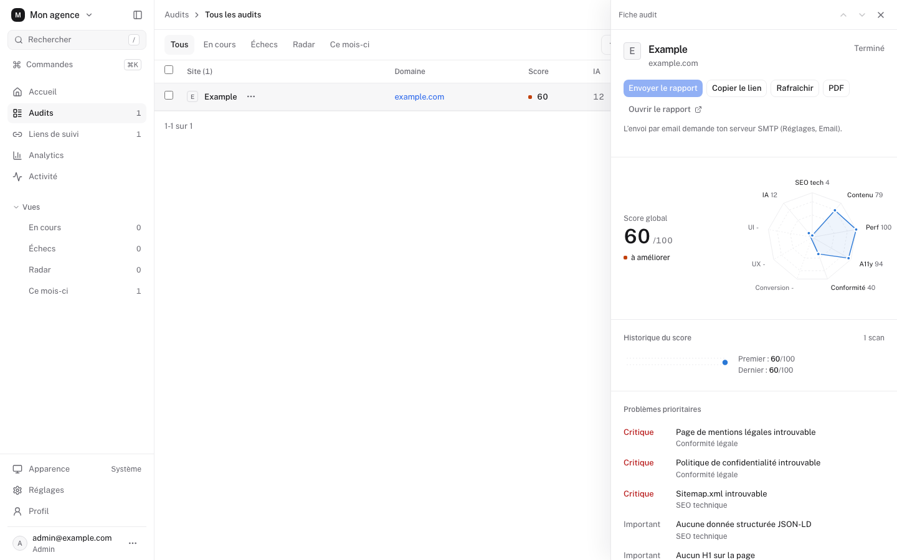

# mynto

Outil d'audit de sites web auto-hébergé, pensé pour les agences. Tu lances un audit, mynto analyse le site sur 8 axes, rédige un rapport à ta marque, te donne un lien de suivi pour le prospect et te prévient quand il l'ouvre.

Licence [AGPL-3.0](LICENSE). Français d'abord, [English below](#english).




## Sommaire

- [Fonctions](#fonctions)
- [Ce que le score ne dit pas](#ce-que-le-score-ne-dit-pas)
- [Prérequis](#prérequis)
- [Démarrage rapide](#démarrage-rapide)
- [Première connexion](#première-connexion)
- [Configuration](#configuration)
- [HTTPS et reverse proxy](#https-et-reverse-proxy)
- [Mises à jour](#mises-à-jour)
- [Sauvegardes](#sauvegardes)
- [Dimensionnement](#dimensionnement)
- [Dépannage](#dépannage)
- [Sécurité](#sécurité)
- [Développement](#développement)
- [Contribuer, licence](#contribuer)
- [English](#english)

## Fonctions

- **Audit sur 8 axes** : SEO technique, SEO contenu, performance (Lighthouse), accessibilité (axe-core), conformité légale (mentions, RGPD, cookies), conversion, UX, UI. Score global sur 100, score par axe, problèmes classés par priorité, chiffrage indicatif du temps de correction.
- **Module Préparation IA** (optionnel) : 24 tests déterministes (robots IA, llms.txt, version Markdown, protocoles MCP et agents, commerce agentique), score à part sur 100. Voir [docs/modules/ai-readiness.md](docs/modules/ai-readiness.md).
- **Rédaction par IA** (optionnelle) : Claude par défaut, Gemini ou Mistral. Sans clé, le rapport garde une synthèse déterministe, sans aucun appel externe.
- **Tableau de bord** : accueil « à faire », liste des audits, fiche audit, historique des scores, Analytics, recherche et commandes (⌘K).
- **Liens de suivi** `/r/<jeton>` : tu sais si le prospect a ouvert le rapport, rien de plus (pas de cookie, IP jamais stockée).
- **Modèles de rapport** : trois modèles fournis (Standard, Compact, Commercial), les tiens en Liquid, polices servies localement, rapport web et PDF identiques. Voir [docs/templates/README.md](docs/templates/README.md).
- **Envoi par email** via ton propre serveur SMTP.
- **API REST v1** et **serveur MCP** (Claude Desktop, Claude Code, tout client MCP). Voir [docs/mcp.md](docs/mcp.md).
- **Webhooks sortants signés** (n8n, Make, Zapier, CRM) : 10 événements, signature HMAC, nouvelles tentatives. Voir [docs/webhooks.md](docs/webhooks.md).
- **Intégration Radar** (optionnelle) : API générique pour un outil de prospection externe. Voir [docs/radar.md](docs/radar.md).

## Ce que le score ne dit pas

Le score mesure des points vérifiables automatiquement. **Il ne vaut pas audit de conformité.**

- L'axe accessibilité repose sur axe-core et Lighthouse : ces outils couvrent **environ 30 % des critères du RGAA**. Un score de 100 ne veut pas dire « conforme RGAA » ni « conforme WCAG ». Seul un audit manuel le peut.
- L'axe conformité légale vérifie la présence de pages et de mentions, pas leur validité juridique.
- N'écris jamais « conforme » dans un rapport sur la seule base de ce score. C'est faux, et c'est un risque juridique pour ton agence.

## Prérequis

- Une machine Linux avec **Docker 24+** et **Docker Compose v2** (ou Docker Desktop).
- **2 vCPU et 4 Go de RAM minimum** (voir [Dimensionnement](#dimensionnement)), 10 Go de disque.
- Un nom de domaine et un reverse proxy pour le HTTPS en production.
- Optionnel : Node 22 et pnpm 9 pour `pnpm run setup` (sinon, une commande Docker fait la même chose).

## Démarrage rapide

```bash
git clone https://github.com/pixelersagency/mynto.git
cd mynto

# 1. Configuration : génère .env avec des secrets frais, demande l'adresse
#    publique, l'email et le mot de passe admin.
pnpm run setup
#    Sans Node sur la machine :
#    docker run --rm -it -v "$PWD:/app" -w /app node:22-alpine node scripts/init-env.mjs
#    Ou à la main : cp .env.example .env, puis remplis chaque [obligatoire].

# 2. Construction des images et démarrage (le premier build prend quelques minutes).
docker compose up -d --build

# 3. Suivi du démarrage.
docker compose ps
docker compose logs -f scanner
```

`pnpm setup` est une commande intégrée de pnpm : écris bien `pnpm run setup`.

Le web écoute sur `127.0.0.1:3000`. Les migrations de la base sont appliquées au démarrage du scanner. Postgres et Redis ne sont jamais exposés.

## Première connexion

1. Ouvre `http://localhost:3000/login` (ou ton domaine derrière le reverse proxy).
2. Connecte-toi avec `ADMIN_EMAIL` et le mot de passe saisi pendant `pnpm run setup`.
3. Va dans **Réglages** : marque de l'agence (nom, logo, favicon, couleur, taux journalier), IA (clé API du fournisseur), Email (SMTP), modules d'audit par défaut.
4. Lance ton premier audit depuis **Nouvel audit**.

Avec `PUBLIC_URL` en `https://`, le cookie de session est marqué `Secure` : la connexion ne fonctionne alors qu'en HTTPS. Pour un essai local en HTTP, garde `PUBLIC_URL=http://localhost:3000`.

Changer le mot de passe : `pnpm admin:hash-password`, colle le résultat dans `ADMIN_PASSWORD_HASH`, puis `docker compose up -d`.

## Configuration

Tout est dans **un seul fichier**, `.env`, lu par le web et le scanner. [.env.example](.env.example) documente chaque variable : obligatoire ou non, valeur par défaut, commande pour générer les secrets.

Les essentielles :

| Variable | Rôle |
|---|---|
| `PUBLIC_URL` | Adresse publique, sans `/` final. Liens envoyés, cookie Secure, HSTS. |
| `ADMIN_EMAIL`, `ADMIN_PASSWORD_HASH` | Le compte admin (un seul par installation). |
| `SESSION_SECRET` | Signe la session. `openssl rand -hex 32` |
| `SCANNER_INTERNAL_TOKEN` | Secret partagé web et scanner. `openssl rand -hex 32` |
| `APP_ENCRYPTION_KEY` | Chiffre clés IA, mot de passe SMTP, secrets de webhooks. `openssl rand -base64 32` |
| `AUDIT_VIEWS_IP_HASH_SECRET` | Empreinte des IP pour le dédoublonnage des ouvertures. `openssl rand -hex 32` |
| `ADMIN_TOKEN` | Routes d'administration internes du scanner. `openssl rand -hex 32` |
| `POSTGRES_PASSWORD` | Mot de passe Postgres (lettres et chiffres). `openssl rand -hex 24` |

Au démarrage, le web et le scanner listent en français chaque variable manquante ou invalide, sans jamais afficher sa valeur. En production, le web refuse de démarrer sans base, compte admin, session ou jeton scanner.

La plupart des réglages (marque, IA, SMTP, modèles, polices, modules, webhooks) se font ensuite dans le tableau de bord et sont stockés en base.

### Rotation de `APP_ENCRYPTION_KEY`

```bash
NEW_KEY="$(openssl rand -base64 32)"
echo "$NEW_KEY"            # note-la en lieu sûr avant d'aller plus loin
docker compose stop web scanner
docker compose run --rm --no-deps -e APP_ENCRYPTION_KEY_NEW="$NEW_KEY" \
  scanner node --import tsx /app/packages/db/src/rotate-key-cli.ts
# Remplace APP_ENCRYPTION_KEY par $NEW_KEY dans .env, puis :
docker compose up -d
# Hors Docker : APP_ENCRYPTION_KEY_NEW="$NEW_KEY" pnpm keys:rotate
```

La commande rechiffre dans une seule transaction les clés IA, le mot de passe SMTP et les secrets de webhooks, et affiche ce qu'elle a fait, jamais les secrets. Si une valeur ne s'ouvre avec aucune des deux clés, rien n'est modifié. Relancer la commande avec les mêmes clés est sans danger.

### Webhooks vers un n8n auto-hébergé

`WEBHOOKS_ALLOW_PRIVATE=1` lève la protection SSRF des webhooks. Plutôt que de l'activer pour tout l'hôte, utilise le réseau dédié :

```bash
docker network create n8n
docker compose -f docker-compose.yml -f docker-compose.n8n.yml up -d
# --profile n8n démarre aussi un n8n si tu n'en as pas
```

Détails et risques : [docs/webhooks.md](docs/webhooks.md) et l'en-tête de [docker-compose.n8n.yml](docker-compose.n8n.yml).

### DNS filtré ou mandaté

Si la machine passe par un VPN ou un DNS d'entreprise qui répond une fausse adresse, chaque audit est refusé comme « adresse privée ». `SCANNER_DNS_RESOLVER=doh` fait résoudre les noms par DNS-over-HTTPS (Cloudflare, puis Google). Les adresses privées et réservées restent refusées.

## HTTPS et reverse proxy

Le web écoute en HTTP sur `127.0.0.1:${MYNTO_PORT:-3000}`. Mets un reverse proxy devant.

**Caddy** (certificat Let's Encrypt automatique), `/etc/caddy/Caddyfile` :

```caddy
audit.ton-agence.fr {
  encode zstd gzip
  reverse_proxy 127.0.0.1:3000
}
```

**Traefik** (dans Docker) : crée `docker-compose.override.yml` :

```yaml
services:
  web:
    ports: !reset []
    networks: [traefik]
    labels:
      - traefik.enable=true
      - traefik.docker.network=traefik
      - traefik.http.routers.mynto.rule=Host(`audit.ton-agence.fr`)
      - traefik.http.routers.mynto.entrypoints=websecure
      - traefik.http.routers.mynto.tls.certresolver=letsencrypt
      - traefik.http.services.mynto.loadbalancer.server.port=3000
networks:
  traefik:
    external: true
```

Dans les deux cas, `PUBLIC_URL=https://audit.ton-agence.fr`. Derrière Cloudflare, ajoute `CDN_TRUST_MODE=cloudflare`.

## Mises à jour

```bash
git pull
docker compose up -d --build
```

Quand des images seront publiées sur un registre (`MYNTO_IMAGE_REGISTRY`, `MYNTO_VERSION`) : `docker compose pull && docker compose up -d`.

Les migrations s'appliquent au démarrage du scanner. Fais une sauvegarde avant chaque mise à jour.

## Sauvegardes

Deux choses à sauvegarder : la base Postgres et le volume des médias (captures, favicons des sites, logo et favicon de l'agence, polices). Garde aussi `.env` (sans `APP_ENCRYPTION_KEY`, les secrets chiffrés en base sont perdus).

```bash
# Base (format custom, compressé)
docker compose exec -T postgres pg_dump -U mynto -Fc mynto > mynto-$(date +%F).dump

# Médias
docker run --rm -v mynto_media:/data:ro -v "$PWD":/backup alpine \
  tar czf /backup/mynto-media-$(date +%F).tar.gz -C /data .
```

Restauration :

```bash
docker compose stop web scanner
docker compose exec -T postgres pg_restore -U mynto -d mynto --clean --if-exists < mynto-AAAA-MM-JJ.dump
docker run --rm -v mynto_media:/data -v "$PWD":/backup alpine \
  sh -c 'cd /data && tar xzf /backup/mynto-media-AAAA-MM-JJ.tar.gz'
docker compose up -d
```

Redis ne contient que des files de travail : inutile de le sauvegarder.

## Dimensionnement

Un audit lance jusqu'à quatre Chromium (rendu, capture, axe-core, Lighthouse), de 400 à 600 Mo chacun. Le worker traite deux audits en parallèle.

| Usage | Machine |
|---|---|
| Essai, quelques audits par jour | 2 vCPU, 4 Go de RAM |
| Agence, des dizaines d'audits par jour | 4 vCPU, 8 Go de RAM |
| Plus | plusieurs scanners (`docker compose up -d --scale scanner=2`), 8 Go chacun |

Sur une petite machine, coupe les collecteurs lourds : `AUDIT_RUN_LIGHTHOUSE=0`, `AUDIT_RUN_AXE=0` (les règles qui en dépendent apparaissent « non exécutées »).

## Dépannage

| Symptôme | Piste |
|---|---|
| Le web ne démarre pas | `docker compose logs web` : la liste des variables manquantes ou invalides s'affiche. |
| `POSTGRES_PASSWORD manquante` | Lance `pnpm run setup` ou remplis `.env`. |
| Connexion impossible en HTTP | `PUBLIC_URL` est en `https://` : cookie Secure. Passe par le HTTPS ou mets `http://localhost:3000` pour un essai. |
| Tous les audits échouent ou scorent 0 | Sortie Internet du scanner : `docker compose exec scanner node -e "fetch('https://example.com').then(r=>console.log(r.status))"`. Derrière un DNS filtré : `SCANNER_DNS_RESOLVER=doh`. |
| `private_ip_resolved` dans les journaux | Le nom résout vers une adresse privée : protection SSRF. Voir « DNS filtré ou mandaté ». |
| Chromium plante | Mémoire : voir [Dimensionnement](#dimensionnement). `shm_size` est à 1 Go dans docker-compose.yml. |
| Webhook vers n8n refusé | Voir [Webhooks vers un n8n auto-hébergé](#webhooks-vers-un-n8n-auto-hébergé). |
| `docker compose stop` lent | Le scanner sort de force après `SHUTDOWN_TIMEOUT_MS` (8 s) ; un audit interrompu reprend au démarrage suivant. |
| Clés IA « indéchiffrables » | `APP_ENCRYPTION_KEY` a changé sans rotation : remets l'ancienne ou ressaisis les clés. |

## Sécurité

- Signale une faille en privé : voir [SECURITY.md](SECURITY.md).
- Seul le web est exposé, sur 127.0.0.1 par défaut. Postgres et Redis sont sur un réseau Docker sans sortie Internet.
- Conteneurs non root, aucun secret dans les images, tout se lit au démarrage.
- Les URL auditées passent une garde anti-SSRF (adresses privées, réservées, métadonnées cloud refusées, adresse épinglée contre le DNS rebinding).
- Clés IA, mot de passe SMTP et secrets de webhooks chiffrés en AES-256-GCM.
- Limites de débit sur la connexion, l'API et le MCP (partagées via Redis).
- Le lien de suivi ne pose aucun cookie et ne stocke jamais d'IP.
- Données personnelles : les audits expirent (60 jours par défaut) et sont purgés ; les ouvertures de rapports sont purgées après 90 jours.
- `gitleaks` tourne en pre-commit et en CI.

## Développement

```bash
pnpm install
pnpm --filter @mynto/scanner exec playwright install chromium  # navigateur des audits
pnpm run setup -- --dev                                      # écrit .env.local
cp docker-compose.override.example.yml docker-compose.override.yml
docker compose up -d postgres redis                          # ou Postgres et Redis locaux
pnpm dev                                                      # web :3000 + scanner :4000
```

Sans Docker, crée le rôle et la base attendus par `DATABASE_URL` dans `.env.local` (le mot de passe est `POSTGRES_PASSWORD` du même fichier) :

```bash
psql -U postgres -c "create role mynto login password '<POSTGRES_PASSWORD>'" -c "create database mynto owner mynto"
```

Les migrations s'appliquent au démarrage du scanner (ou `DATABASE_URL=... pnpm db:migrate`). `pnpm dev` lit la configuration dans `.env.local` seulement : les variables exportées dans le shell ne passent pas par turbo. Pour lancer un service avec d'autres valeurs, utilise `pnpm --filter @mynto/scanner dev` ou `pnpm --filter @mynto/web dev`.

Contrôles : `pnpm typecheck`, `pnpm lint`, `pnpm test` (les tests d'intégration lancent un Postgres jetable : `initdb` local, Docker, ou `TEST_DATABASE_URL`), `pnpm --filter @mynto/web build`.

Documentation : [docs/README.md](docs/README.md).

## Contribuer

Les contributions sont bienvenues : lis [CONTRIBUTING.md](CONTRIBUTING.md) et le [code de conduite](CODE_OF_CONDUCT.md).

## Licence

[GNU Affero General Public License v3.0](LICENSE) (`AGPL-3.0-only`). Si tu modifies mynto et le proposes à d'autres via un réseau, tu dois leur donner accès au code source modifié. Licences des dépendances : [THIRD_PARTY_NOTICES.md](THIRD_PARTY_NOTICES.md).

---

## English

mynto is a self-hosted website audit tool for agencies. Run an audit, get an 8-axis analysis (technical SEO, content SEO, performance, accessibility, legal compliance, conversion, UX, UI) plus an optional AI-readiness module, a branded report (web and PDF), a tracking link that tells you when the prospect opened it, a REST API, an MCP server and signed outgoing webhooks.

**The score is not a compliance audit.** Accessibility relies on axe-core and Lighthouse, which cover roughly 30% of RGAA / WCAG success criteria. Never present a score as "compliant".

### Quick start

Requirements: Docker 24+ with Compose v2, 2 vCPU / 4 GB RAM minimum.

```bash
git clone https://github.com/pixelersagency/mynto.git && cd mynto
pnpm run setup            # or: docker run --rm -it -v "$PWD:/app" -w /app node:22-alpine node scripts/init-env.mjs
docker compose up -d --build
```

Then open `http://localhost:3000/login` and sign in with the admin email and password you entered. Put a reverse proxy (Caddy, Traefik) in front for HTTPS and set `PUBLIC_URL` to your `https://` address.

### Operations

- Configuration: one `.env` file, every variable documented (in French) in [.env.example](.env.example). Both services print missing or invalid variables at startup.
- Updates: `git pull && docker compose up -d --build` (or `docker compose pull && docker compose up -d` once images are published).
- Backups: `pg_dump` of the `postgres` service plus the `mynto_media` volume, and keep your `.env`.
- Encryption key rotation: `pnpm keys:rotate` with `APP_ENCRYPTION_KEY` (current) and `APP_ENCRYPTION_KEY_NEW`.
- Filtered or proxied DNS: `SCANNER_DNS_RESOLVER=doh`.
- Self-hosted n8n webhooks: `docker-compose.n8n.yml`.

### Docs, security, license

Documentation index: [docs/README.md](docs/README.md). Security reports: [SECURITY.md](SECURITY.md). Contributions: [CONTRIBUTING.md](CONTRIBUTING.md). License: [AGPL-3.0-only](LICENSE), third-party licenses in [THIRD_PARTY_NOTICES.md](THIRD_PARTY_NOTICES.md).
